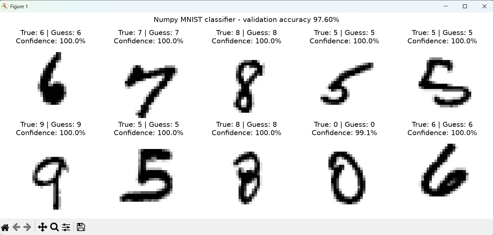
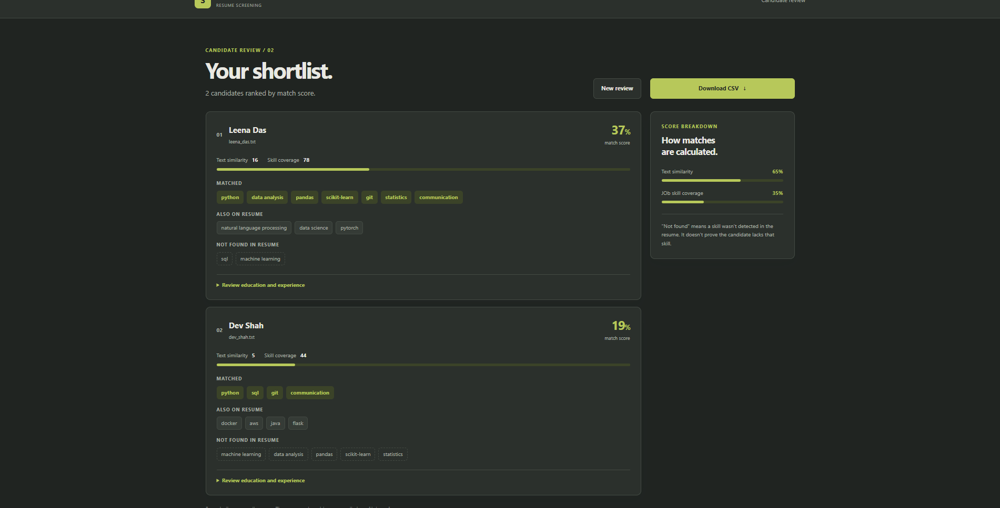

# AI Internship Projects

Small projects I built during my AI internship, from a NumPy digit classifier to local AI tools in the browser. The work is split into two weeks; each project has its own folder and can be run on its own.

## Week 1 · Python and machine learning

### Handwritten digit recognizer

A neural network built with NumPy and trained on Kaggle's Digit Recognizer data. It reached **97.60% validation accuracy**. I included the trained weights so the demo scripts can show predictions without retraining.

### Rule-based chatbot

A simple terminal chatbot that matches what you type against topics like AI, Python, studying, and projects.

### Tic-Tac-Toe

A Tkinter game with Human vs AI and AI vs AI modes. The computer chooses moves with minimax.

## Week 2 · Local AI web apps

### AI/ML project mentor

A chat assistant for working through an AI/ML project, from choosing a problem and dataset to evaluating and debugging a model. It uses Ollama locally and can optionally search approved documentation sources.

### Resume screening assistant

Compare PDF or TXT resumes with a job description and get a ranked shortlist. The score weighs text similarity at 65% and detected skill coverage at 35%; results can be exported as CSV. It is a way to organize a review, not a substitute for reading the resumes.

### Writing assistant

Generate or revise blog posts and social captions. Choose the tone, length, audience, and key points, then shape the draft with follow-up instructions. Text generation runs through a local Ollama model.

## Run Week 2

These apps use a shared Python environment and the dependencies in `AI-intern week 2/requirements.txt`. In PowerShell, run this once from the repository root:

~~~powershell
py -m venv "AI-intern week 2/.venv"
& "AI-intern week 2/.venv/Scripts/Activate.ps1"
python -m pip install -r "AI-intern week 2/requirements.txt"
~~~

Then run the app you want from its folder:

~~~powershell
cd "AI-intern week 2/Resume_Screening_AI"
python app.py
~~~

~~~powershell
cd "AI-intern week 2/AI_chatbot"
ollama pull qwen3:4b-instruct
python app.py
~~~

~~~powershell
cd "AI-intern week 2/AI_content_Generator"
ollama pull qwen3.5:4b
python app.py
~~~

Open `http://127.0.0.1:5000` in your browser. The mentor and writing assistant need Ollama running locally. The resume screener accepts up to 20 resumes per review.

## Run Week 1

Create and activate a virtual environment in the Week 1 folder, then install its dependencies:

~~~powershell
cd "AI-intern week 1"
py -m venv .venv
.venv\Scripts\Activate.ps1
python -m pip install -r requirements.txt
~~~

The digit recognizer needs `train.csv`, `test.csv`, and `sample_submission.csv` from [Kaggle's Digit Recognizer data page](https://www.kaggle.com/competitions/digit-recognizer/data), saved under `AI-intern week 1/data/`. Run `python neural_network.py` to train, `python present_network.py` to view sample predictions, or `python predict_test.py` to write a Kaggle submission. The other projects start with `python chatbot.py` and `python tic_tac_toe.py`.

The Kaggle CSVs, generated submissions, virtual environments, and Python cache files are kept out of Git. The included `mnist_model.npz` contains the trained weights used by the digit recognizer demos.
