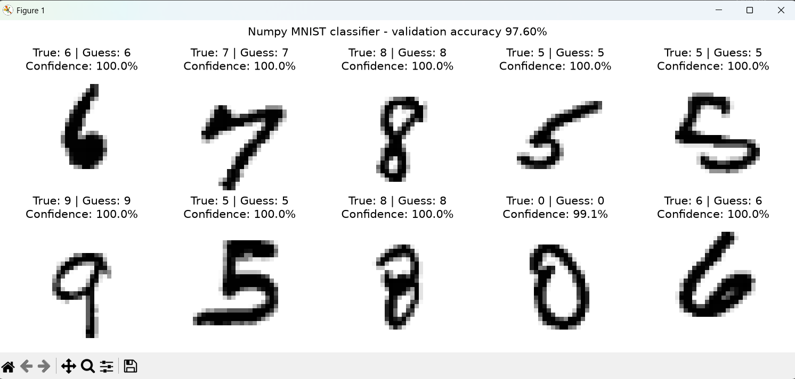
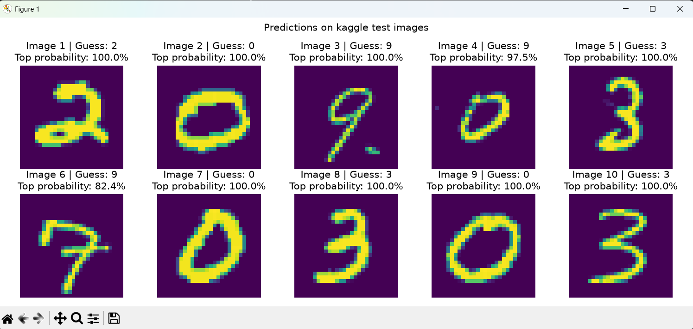
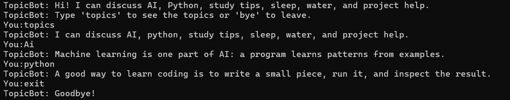
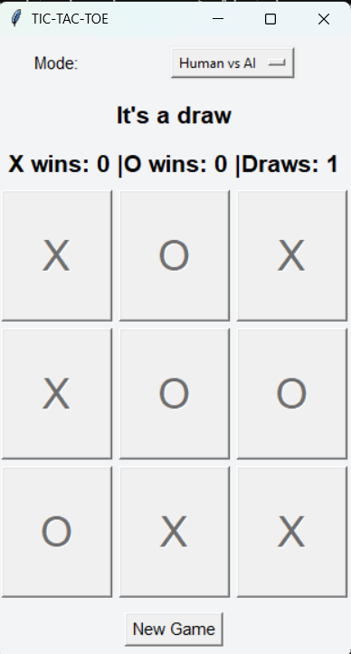

# AI Internship Projects

Week 1 includes three Python projects built for the AI Internship tasks. The goal was to implement the required ideas and understand how each part works.

## Week 1 results

| Task | What it does | Result |
|---|---|---|
| Basic Neural Network | Classifies handwritten digits from the Kaggle MNIST Digit Recognizer dataset using NumPy. | **97.60% validation accuracy** and **0.1804 validation cross-entropy loss**. Training stopped early after 12 epochs; the best validation loss was reached at epoch 9. |
| Rule-Based Chatbot | Matches user messages to topics with regular expressions and chooses a response from the matching intent. | Supports six topics: AI, Python, study tips, project help, sleep, and water; includes help/topics commands, fallback replies, and avoids repeating the same topic reply immediately. |
| Tic-Tac-Toe | Tkinter GUI game with Minimax decision-making. | Supports Human vs AI and AI vs AI, detects wins and draws, prefers faster wins, and tracks X wins, O wins, and draws across rounds. |

## Project screenshots

### Basic Neural Network — validation predictions

### Basic Neural Network — Kaggle test predictions

### Rule-Based Chatbot

### Tic-Tac-Toe

## Week 1 folder

~~~text
ai-internship-projects/
├── .gitignore
├── README.md
└── AI-intern week 1/
    ├── chatbot.py
    ├── neural_network.py
    ├── present_network.py
    ├── predict_test.py
    ├── tic_tac_toe.py
    ├── mnist_model.npz
    ├── requirements.txt
    └── data/  # Download Kaggle CSVs here; ignored by Git
~~~

## 1. Basic Neural Network

Implemented with **NumPy**, without a machine-learning framework:

- Input: 784 pixel values from each 28×28 grayscale image, scaled to the range 0–1.
- Hidden layer: 128 units with ReLU activation.
- Output: 10 digit classes with softmax probabilities.
- Training: mini-batches, cross-entropy loss, backpropagation, momentum, a stratified validation split, and early stopping.
- Visualizations: training/validation loss and accuracy, a validation confusion matrix, and example predictions.

The saved weights are in mnist_model.npz.

### Dataset

Download the Kaggle **Digit Recognizer** files and put train.csv, test.csv, and sample_submission.csv in AI-intern week 1/data/. The data files are intentionally excluded from this repository.

### Setup and run (Windows)

From the repository root, enter the Week 1 folder:

~~~bat
cd "AI-intern week 1"
py -m venv .venv
.venv\Scripts\activate
python -m pip install -r requirements.txt
~~~

Train the network and save its weights:

~~~bat
python neural_network.py
~~~

Show validation predictions using the saved model, without retraining:

~~~bat
python present_network.py
~~~

Predict the unlabeled Kaggle test images and create a submission file:

~~~bat
python predict_test.py
~~~

predict_test.py writes submission.csv. Kaggle's test file does not contain labels, so this script cannot calculate test accuracy.

## 2. Rule-Based Chatbot

Run from the Week 1 folder:

~~~bat
python chatbot.py
~~~

It normalizes capitalization, checks regular-expression patterns for supported topics, selects a topic-specific response, and uses a fallback if no intent matches. Type help or topics for the topic list; type bye to exit.

This is a rule-based chatbot: its responses depend on the patterns and response lists in chatbot.py. It does not use a trained language model or retain conversational context.

## 3. Tic-Tac-Toe

Run from the Week 1 folder:

~~~bat
python tic_tac_toe.py
~~~

Choose **Human vs AI** or **AI vs AI** from the mode selector. Minimax searches possible future moves; terminal scores favor quicker wins and delay unavoidable losses. The score display tracks X wins, O wins, and draws. **New Game** clears the board while preserving the score totals.

## Notes

- The neural network result is from the recorded validation run; results can vary if training settings or the data split change.
- The model is a learning project intended to demonstrate the neural-network workflow, not a production OCR system.
- Kaggle attribution: dataset from the [Digit Recognizer competition](https://www.kaggle.com/competitions/digit-recognizer/data).

