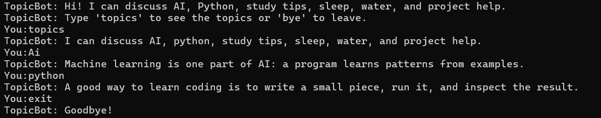
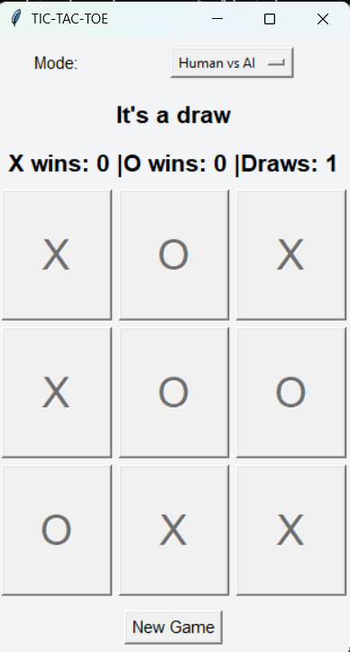
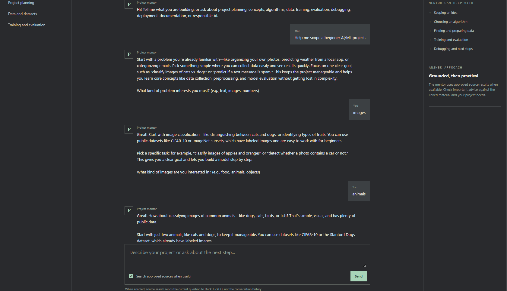
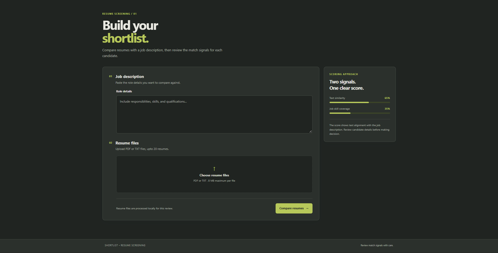
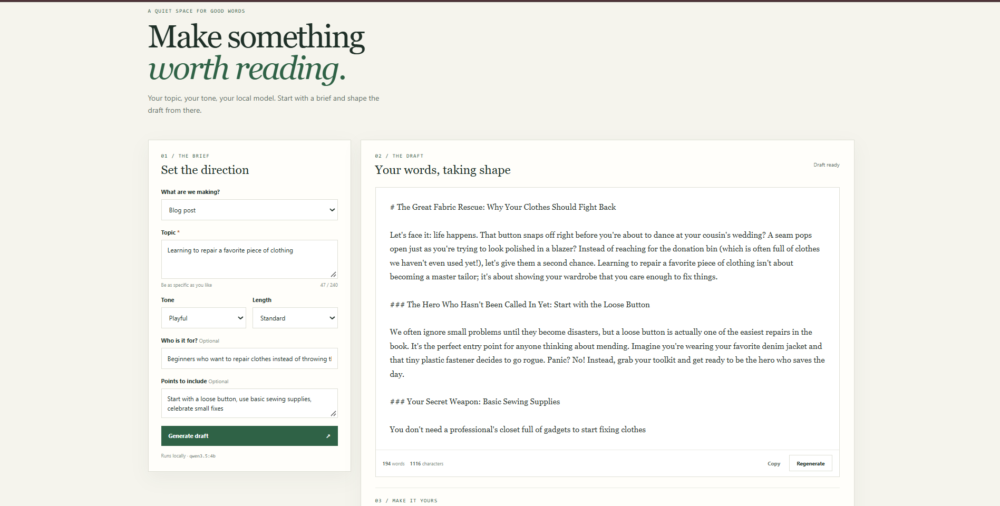
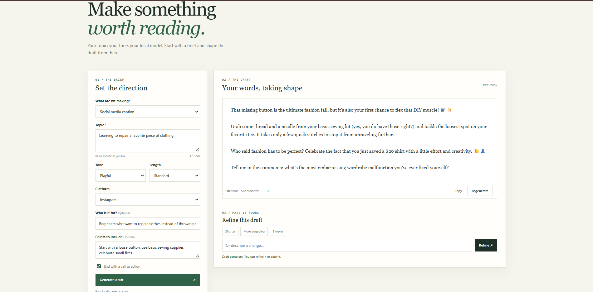

# AI Internship Projects

This repository contains projects I built during my AI internship. Week 1 was about getting comfortable with basic machine learning and Python projects. In Week 2, I built three small web apps: an AI/ML project mentor, a resume screener, and a writing assistant.

## Week 1

### Handwritten digit recognizer

A NumPy neural network that recognizes handwritten digits from Kaggle's Digit Recognizer dataset. It reached **97.60% validation accuracy**. The saved weights are included so the demo scripts can run without training again.

### Rule-based chatbot

A terminal chatbot that responds to questions about topics such as AI, Python, studying, and projects.

### Tic-Tac-Toe

A Tkinter game with Human vs AI and AI vs AI modes. The AI uses minimax to choose its moves.

## Week 2

### AI/ML project mentor

A browser-based mentor for planning AI and machine learning projects. It can help with project scope, algorithms, datasets, training, evaluation, debugging, and documentation. Answers use a local Ollama model; optional source search looks for material from approved documentation sites.

### Resume screening assistant

Upload PDF or TXT resumes alongside a job description to get a ranked shortlist. The score combines text similarity (65%) with coverage of detected job skills (35%), and the results can be downloaded as a CSV. It is a comparison aid; review each resume yourself before making a decision.

### AI writing assistant

Create a blog post or social caption by choosing a topic, tone, length, audience, and key points. You can also ask the app to revise a draft. Text generation runs through a local Ollama model.

## Running the projects

The examples below use Windows PowerShell. Python packages are installed separately for each project, so create and activate a virtual environment inside the project folder before installing them.

~~~powershell
cd "AI-intern week 2/Resume_Screening_AI"
py -m venv .venv
.venv\Scripts\Activate.ps1
python -m pip install Flask pdfplumber scikit-learn
python app.py
~~~

Open the local address printed by Flask in your browser. The resume screener accepts PDF and TXT files, up to 20 resumes per review.

### AI/ML project mentor

Install the app's Python dependencies, then run Ollama locally and download the default model (`qwen3:4b-instruct`). With Ollama available, start the app:

~~~powershell
cd "AI-intern week 2/AI_chatbot"
py -m venv .venv
.venv\Scripts\Activate.ps1
python -m pip install Flask requests beautifulsoup4
ollama pull qwen3:4b-instruct
python app.py
~~~

Open `http://127.0.0.1:5000`. You can set the `OLLAMA_MODEL` environment variable before starting the app to use another installed Ollama model. The app also has rule-based fallback replies if Ollama is unavailable.

### AI writing assistant

This app uses Ollama's `qwen3.5:4b` model by default. Start Ollama, install the Python dependencies, pull the model, and run the app:

~~~powershell
cd "AI-intern week 2/AI_content_Generator"
py -m venv .venv
.venv\Scripts\Activate.ps1
python -m pip install Flask requests
ollama pull qwen3.5:4b
python app.py
~~~

Open the local address printed by Flask. Set `OLLAMA_MODEL` if you want to use a different model that's available in Ollama.

### Week 1 projects

Create a virtual environment in `AI-intern week 1` and install that folder's requirements:

~~~powershell
cd "AI-intern week 1"
py -m venv .venv
.venv\Scripts\Activate.ps1
python -m pip install -r requirements.txt
~~~

For the digit recognizer, download `train.csv`, `test.csv`, and `sample_submission.csv` from the [Kaggle Digit Recognizer data page](https://www.kaggle.com/competitions/digit-recognizer/data) into `AI-intern week 1/data/`. Then run `python neural_network.py` to train, `python present_network.py` to view sample predictions, or `python predict_test.py` to create a Kaggle submission. The chatbot and game run with `python chatbot.py` and `python tic_tac_toe.py`.

## Data and local files

Kaggle CSV files and generated submission files are kept out of Git. Virtual environments and Python cache files are also ignored. The included `mnist_model.npz` is the small set of trained weights used by the Week 1 demos; it is not a copy of the Kaggle dataset.
